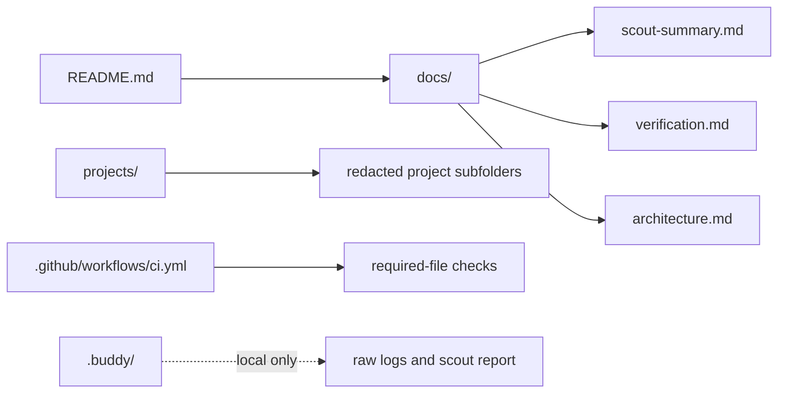
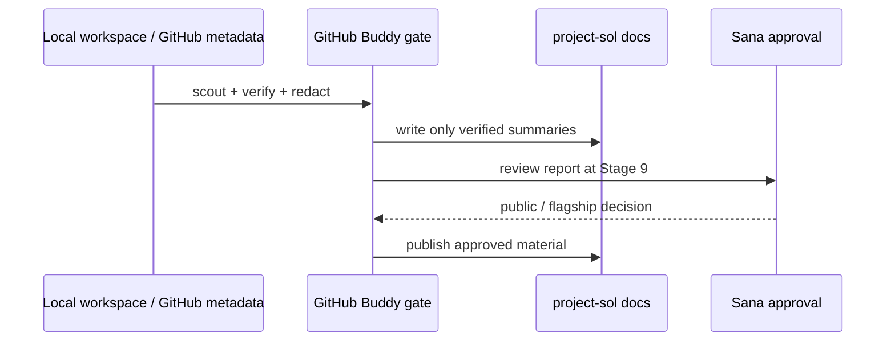
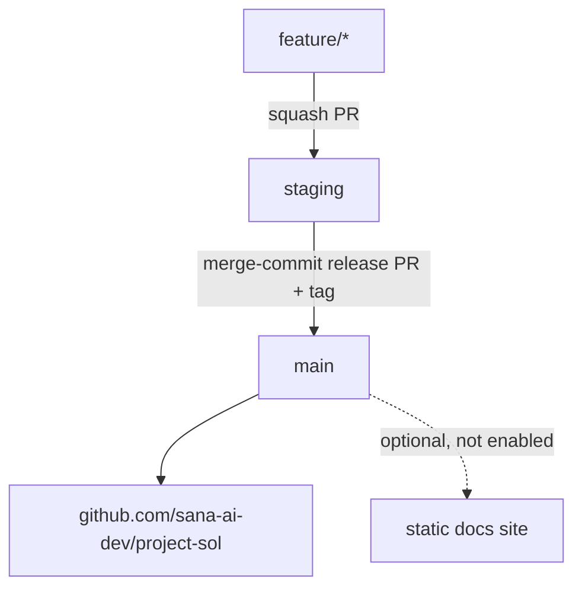

# Architecture

This is a documentation-and-curation repository. There is no runtime service; the components below are files and folders, not processes.

## Components

Derived from: `README.md`, `docs/`, `projects/README.md`, `.github/workflows/ci.yml`, `.buddy/scout-report.md`. The dotted edge is deliberately local and git-ignored.

## Data flow

No automatic path bypasses the approval step.

## Deployment layout

`main` is released, `staging` is integration. No force push, history rewrite or direct push to either protected branch.

## Diagram sources

- Mermaid blocks above are the always-available source of truth.
- Excalidraw export was skipped: no recognised CLI was present. No `.svg` is claimed.
