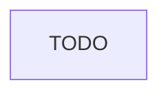

# Architecture

<!-- Every component must exist in the code. Mermaid is the fallback when no Excalidraw export was produced. -->

## Components

TODO: one line per real component, naming the file or folder it lives in.



## Data flow

TODO

```mermaid
sequenceDiagram
  TODO
```

## Diagram sources

- Keep `docs/diagrams/*.excalidraw` with its exported `.svg` where the CLI produced one.
- If the export was skipped, say so here and rely on the Mermaid blocks.
