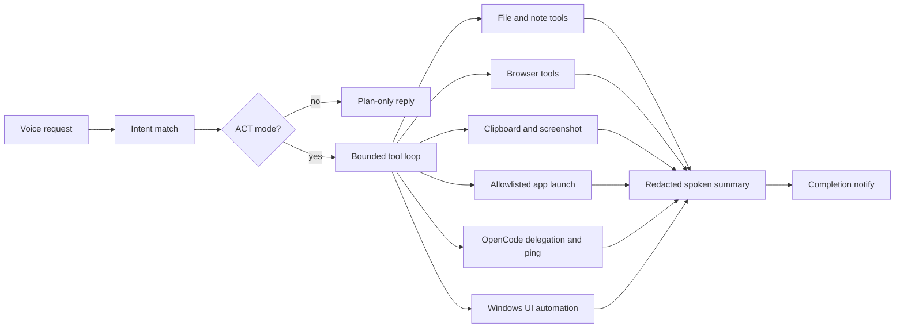
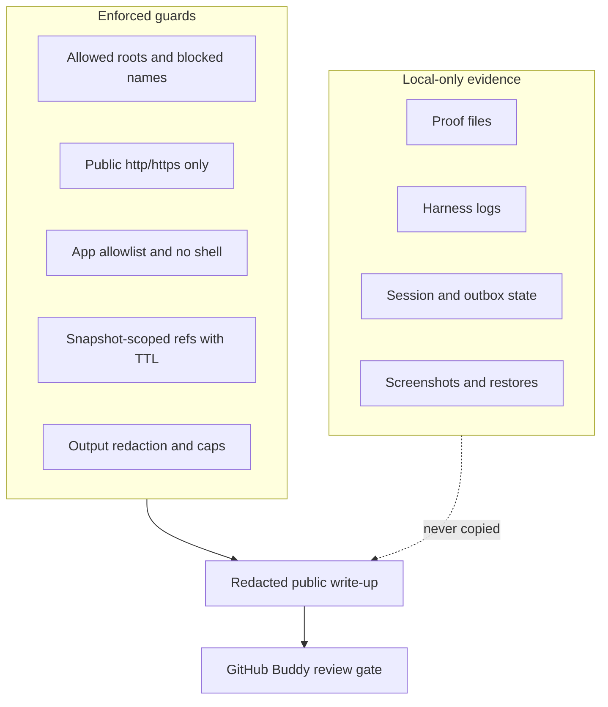
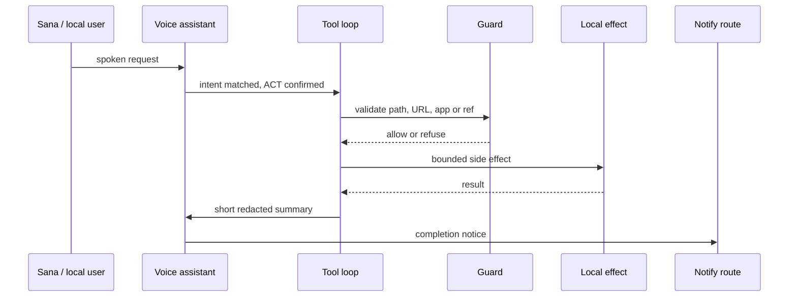

# Xara toolbelt architecture

This page describes the verified pattern, not a shipped runtime. All blocks are Mermaid because no Excalidraw CLI was available.

## Components

Derived from the slice 1, slice 2, session-ping, permission-notify and desktop UIA proofs.

## Trust boundary

The dotted edge is the deliberate boundary: private evidence informs the claims but is not published.

## Execution flow

## Diagram sources

- Tool names, ACT gate and notify flow: slice 1 and slice 2 proofs.
- Ping path: session-ping proof.
- Redaction, URL filtering and ref TTL: desktop UIA proof.
- Publication boundary: `docs/scout-summary.md` and this hub's approval gate.
